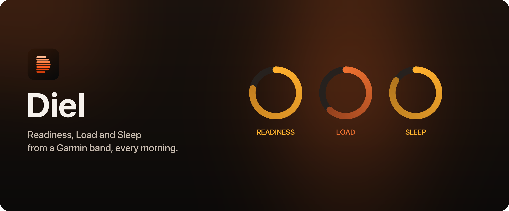
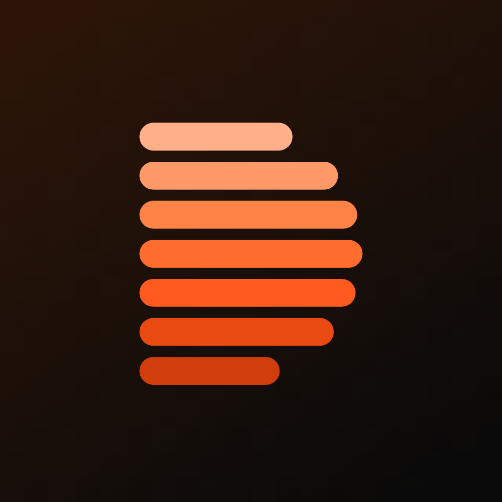
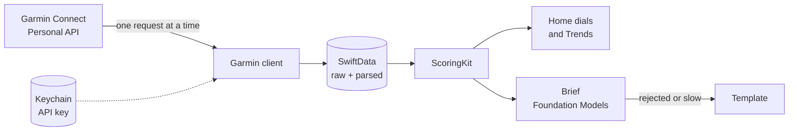

<p align="center">
  
</p>

<p align="center">
  
  
  
  
  
  
</p>

Diel is my iPhone app for three questions each morning. Am I ready? How hard
have I worked today? How did I sleep? It reads my Garmin Cirqa band through the
Garmin Connect Personal API and answers with three dials and a short written
brief.

It's built for one person and isn't on the App Store. This repository has the
app and its scoring code. My Garmin data stays out of it, and so do the tests
that read that data. [What's not here](#whats-not-in-this-repo) explains why.

## The three dials

### Readiness

Diel's own estimate, not Garmin's. It compares last night's HRV, daily resting
heart rate and recent sleep against my own history. The HRV and resting heart
rate trends use exponentially weighted means with a three-day half-life. The
score sits on a scale centred on 50 and clamped to 5 to 95.

Every score comes with one reason, for example "HRV 10% above normal". The
detail screen lists each input next to my normal, so I can see why the number
moved.

### Load

All-day heart-rate load. Diel runs a Banister TRIMP over Garmin's timestamped
heart-rate samples and maps the total onto 0 to 100. It only goes up during a
day.

Below 10 it says "No training yet". Above that it compares against my usual load
for the same time of day. Each activity keeps Garmin's own load number, which
can go past 100.

### Sleep

Garmin's Sleep Score, credited to Garmin on the detail screen. Diel adds
duration against need and the stage totals. When Garmin has no score, the dial
shows a dash. Diel never makes one up.

Missing data stays missing everywhere. A night without HRV shows as missing
instead of falling back to a trend, and the detail screens mark inputs that were
partial. The exact formulas, weights and wording rules are in
[AGENTS.md](AGENTS.md) under "Dial meanings". The scoring code lives in
[ScoringKit](ScoringKit), a Swift package with no UI.

## Morning check-in and brief

Before the dials appear, Diel asks "How do you feel?" on a 1 to 5 scale. The
answer feeds the brief and a rating history I'll use to check whether the
Readiness weights hold up.

The brief is two sentences written on the phone by Apple's Foundation Models. A
validator rejects any draft that states a number missing from the day's data or
drops a known score. A plain template takes over when the model is unavailable,
takes longer than 10 seconds or gets rejected. Diel writes the brief once a day
and rewrites it only when Readiness, Sleep or the Load state changes.

## Themes

Diel is dark only. Three themes change the dial colours, the glow behind Home
and the app icon together. Ember is the default, warm orange on near-black.
Lunar is greyscale with a cool blue Load ring. Classic uses teal for Readiness
and Sleep and orange for Load. The design rules, tokens and motion are in
[DESIGN.md](DESIGN.md).

<p>
  
</p>

## How it fits together



Diel only pulls. It syncs on launch, every 15 minutes while open, and from a
morning background refresh. A 90-day catch-up runs overnight while the phone
charges.

Each sync fetches today first: last night's sleep, HRV and heart rate, plus the
summary ranges that include today. Scores update as soon as those arrive, and
older days catch up afterwards. Past days that are already final aren't
downloaded again. Requests go out one at a time and back off when Garmin returns
429 or 5xx.

SwiftData keeps both the raw responses and the parsed values, so the app opens
with yesterday's numbers even offline.

## Privacy

You paste a Garmin API key into Settings and the app stores it only in the iOS
Keychain. It never appears in code, logs or commits. The app talks only to
Garmin's API, and the brief model runs on the phone.

## What's not in this repo

Diel's tests are built on real Garmin responses from my own band: sleep, HRV,
heart rate and activities. That data is personal, so it lives in a private
repository together with everything that depends on it:

- `fixtures/`, the saved Garmin responses
- the unit tests, UI tests and ScoringKit tests, which read those fixtures
- the Debug sample-data mode's bundled fixtures, so that mode has nothing to show here
- the build plan and per-phase verification reports and screenshots

That's also why this README has no app screenshots. Every screenshot I have
shows my own numbers. The code here builds and runs against your own Garmin
account.

## Building

You need Xcode 27 with the iOS 27 SDK. The deployment target is iOS 27.0.

1. Open `Diel.xcodeproj`, pick the `Diel` scheme and an iPhone, and run.
2. On first launch, open Settings and paste a Garmin Connect Personal API key.

To run it on a device you'll need to set your own signing team in the project.

There are no third-party packages. The stack is Swift 6, SwiftUI, Observation,
SwiftData, Swift Charts and URLSession.

<details>
<summary><b>Build checks</b></summary>

<br>

```bash
swift build --package-path ScoringKit
```

```bash
swift format lint --recursive --strict Diel ScoringKit
```

</details>

<details>
<summary><b>Repo layout</b></summary>

<br>

```text
Diel/            app sources: Garmin client, sync, persistence, scoring service, screens
ScoringKit/      Swift package for baselines and the three scores
design/          app icons and the README banner
scripts/         build metadata helper
```

</details>

## Docs

- [AGENTS.md](AGENTS.md) has the product rules, the Garmin API notes and how to build.
- [DESIGN.md](DESIGN.md) has the design rules: themes, tokens, motion and the identity anchors.
